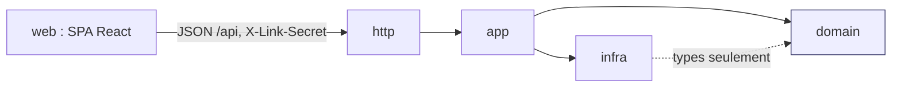
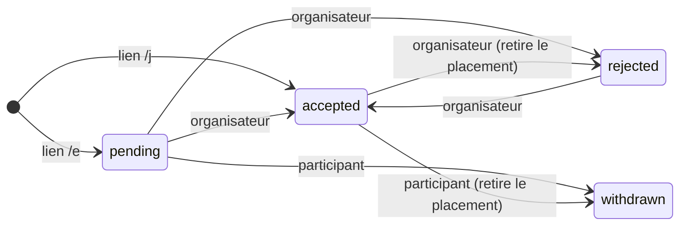
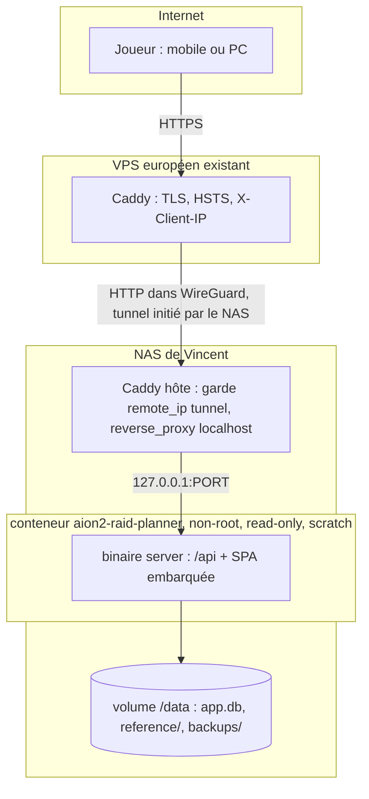
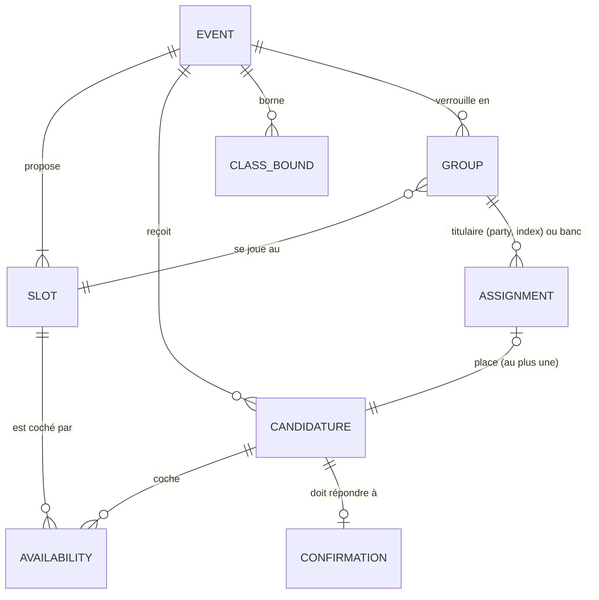
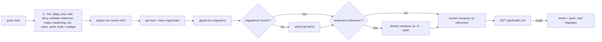

# Architecture Spine — aion2-raid-planner

Rédigée en fast path le 2026-11-05, passée par la porte de revue (réconciliation des trois sources,
grille, versions, attaque adversaire). Chaque `[ASSUMPTION]` est un choix fait sans Vincent, à confirmer
ou corriger à la relecture. Le pourquoi de chaque décision vit dans `.memlog.md` à côté.

**Relecture de Vincent (2026-11-05) :** toutes les `[ASSUMPTION]` sont confirmées. Le rôle reste dérivé
de la classe ; la page publique ne montre pas la liste nominative. Seule reste ouverte la question
juridique sur la conservation des adresses IP (Deferred).

## Design Paradigm

**Monolithe modulaire en couches, noyau pur.** Un seul binaire Rust, un seul conteneur, un seul fichier
de base. Le noyau (`domain`) est un crate Cargo séparé sans aucune I/O : entités, machines d'états,
validation, solveur, prédicats de temps. Le serveur (`server`) l'enveloppe en trois couches concrètes
`http → app → infra` : `app` appelle `infra::sqlite` directement, sans trait de dépôt ; seuls l'horloge
(`Clock`) et le générateur d'ids et de secrets sont des traits injectés, pour les tests. La SPA React ne
connaît que le contrat JSON de `http`.

| Couche | Emplacement | Contient | Ne contient jamais |
| --- | --- | --- | --- |
| domain | `crates/domain/` | entités, états, règles, validation, `compose()`, `Timestamp`, prédicats de temps | sqlx, axum, tokio, horloge système, aléa non injecté |
| app | `crates/server/src/app/` | commandes (écritures transactionnelles), requêtes (lectures par droit), tâches périodiques, `health()` | parsing HTTP, SQL hors `infra` |
| infra | `crates/server/src/infra/` | pools SQLite, migrations, chargeur de référence, horloge, générateur d'ids et de secrets | règles métier |
| http | `crates/server/src/http/` | routes Axum, extracteurs (`LinkSecret`, IP visiteur), DTO par droit, registre des codes d'erreur, limites, assets embarqués, en-têtes | logique métier, SQL |
| web | `web/` | SPA React, locales fr/en, `client.ts`, `links.ts`, miroir TS des DTO | valeur de référence du jeu en dur, secret hors en-tête |



Sens unique : une couche ne dépend que de celles à sa droite. `domain` ne dépend de rien du projet.
`infra` n'appelle jamais `app` ni `http`. `web` n'importe rien du Rust : le contrat passe par `types.ts`.

## Invariants & Rules

### AD-1 — Un seul conteneur, un seul binaire qui sert l'API et le build React (Q11)

- **Binds:** all
- **Prevents:** deux images à durcir, un nginx à suivre, deux blocs Caddy, CORS et origines distinctes ;
  un binaire livré avec des assets périmés.
- **Rule:** le binaire `server` sert `/api/*` et le build Vite embarqué par `rust-embed` depuis
  `web/dist/`, avec repli sur `index.html` pour toute route GET sans extension et 404 pour un asset absent.
  Aucun autre processus ni image en production. Pas de CORS : même origine. Ordre de build fixé : `vite
  build` précède toute commande `cargo` (CI et `Dockerfile` multi-étapes `node → rust → runtime`,
  `web/dist/` copié depuis l'étape `node`) ; le crate serveur n'invoque jamais npm ; `web/dist/.gitkeep`
  versionné pour que `cargo check` passe sans build web.

### AD-2 — SQLite seule, un fichier dans le volume de données (Q11)

- **Binds:** app, infra, deploy, CAP-7, OPS
- **Prevents:** un second service à sécuriser et sauvegarder ; le partage du PostgreSQL d'un autre
  service ; deux politiques de pool ; une restauration improvisée.
- **Rule:** toute persistance passe par SQLx sur `/data/app.db`. Pragmas à l'ouverture :
  `journal_mode=WAL`, `synchronous=NORMAL`, `foreign_keys=ON`, `busy_timeout=5000`. Deux pools : écriture
  `max_connections = 1`, lecture `max_connections = 4` ; toute commande (AD-16) prend le pool d'écriture.
  Migrations `sqlx::migrate!` embarquées, appliquées au démarrage, forward-only, immuables une fois
  poussées sur `main` : un commit qui ajoute une migration ne se revert pas, le retour arrière est une
  migration de compensation. Sauvegarde quotidienne par `VACUUM INTO` dans `/data/backups/`
  (`[ASSUMPTION]` deux conservées) et avant tout déploiement qui touche `migrations/` (AD-10).
  Restauration = `docker compose stop`, copie de la sauvegarde sur `/data/app.db`, suppression des
  fichiers `-wal` et `-shm`, `up`. Rien de persistant hors `/data`.

### AD-3 — Droits portés par des liens secrets ; aucun secret de lien en clair en base [ADOPTED]

- **Binds:** CAP-1, CAP-2, CAP-5, RECONF, ADMIN, http, web
- **Prevents:** un handler qui lit un secret dans l'URL ; un lien qui agit sur GET ; une fuite de base
  qui donne les droits ; un second mécanisme d'identité ; un client qui envoie le mauvais secret.
- **Rule:** trois secrets de lien de 256 bits (CSPRNG, base64url sans padding, 43 caractères) : `/o/`
  organisateur et `/j/` candidature directe, un par événement ; `/p/` participant, un par candidature ;
  plus `/e/<id>` lecture publique et candidature à valider, id aléatoire de 128 bits (base64url 22
  caractères, indevinable). L'administration utilise `ADMIN_SECRET` de l'environnement par le même
  mécanisme sur `/api/admin/*` ; variable absente = routes absentes. Le serveur stocke `SHA-256(secret)`
  et cherche par le hash. L'API reçoit un secret uniquement dans l'en-tête `X-Link-Secret`, jamais en
  query string ni cookie. Un extracteur unique `LinkSecret` ne résout que le droit que la route déclare
  et vérifie que l'objet visé est dans la portée du secret : secret d'un autre droit ou d'une autre
  portée = 403 `auth.wrong_right`, secret inconnu = 404, secret absent = 401 `auth.missing`. GET et HEAD
  n'ont jamais d'effet ; tout changement est un POST déclenché par un geste explicite. Les chemins `/o`,
  `/j`, `/p` et les `/e/` d'un événement `unlisted` portent `X-Robots-Tag: noindex` et aucune métadonnée
  `og:`. Aucune récupération : lien perdu = réinscription ou expiration. Côté client, un seul module
  `links.ts` lit et écrit `localStorage` sous le schéma versionné `links.v1 = { [eventId]: { organizer?,
  join?, participants: { [candidatureId]: secret } } }` (le DTO participant porte `candidatureId`) ;
  c'est « Mes événements », et « Dupliquer l'événement » préremplit l'écran de création depuis cette
  entrée, sans route ni droit nouveau. Le client n'envoie que le secret du chemin courant, jamais un
  secret lu en `localStorage` pour une autre page. `[ASSUMPTION]` la SPA laisse le secret dans la barre
  d'adresse (copier l'URL suffit pour changer d'appareil).

### AD-4 — L'événement est l'unique agrégat ; attributs, mutabilité, états et propriétaires fixés

- **Binds:** domain, app, CAP-1, CAP-3, CAP-5, COMP, RECONF, CONTACT, ADMIN
- **Prevents:** deux modules qui écrivent la même ligne sans règle ; des statuts calculés différemment
  côté client et côté serveur ; une entité « campagne » séparée ; une entité joueur transverse aux
  événements, une table ou un index clé par `Pseudo[SRV]` hors d'un événement ; deux formes du
  placement ; un retrait qui laisse un titulaire fantôme.
- **Rule:**
  - *Attributs de l'événement* : `instance`, `region`, `faction_scope` (`all` ou une faction, permis par
    l'instance), `visibility` (`listed` ou `unlisted`, écrit par l'organisateur seul), `admin_unlisted_at`
    (écrit par l'administration seule), `min_cp` optionnel (signal, jamais une contrainte du solveur,
    `[ASSUMPTION]`), `discord_url` optionnel, `note` (le seul texte libre de l'outil, `[ASSUMPTION]`
    ≤ 280 caractères sans URL). Collections : 1..N `slots`, 0..N `candidatures`, `class_bounds`, et
    0..K `groups`.
  - *Candidature* : pseudo, serveur, classe, CP, disponibilités par créneau, préférence, `origin`
    (`direct` ou `public`, stocké) ; aucun autre champ. Faction déduite du serveur, rôle déduit de la
    classe (AD-6). Invariants : serveur dans la région de l'événement, faction dans la portée. Deux
    candidatures avec le même `Pseudo[SRV]` sont permises et signalées à l'organisateur (`[ASSUMPTION]`).
  - *Mutabilité* : `instance`, `region`, `faction_scope` immuables dès la première candidature ; `slots`
    modifiables en `open` seulement (suppression = cascade déclarée des `availabilities` et des `groups`
    du créneau, le DTO organisateur prévient par `slot.hasGroups`) ; `note`, `discord_url`,
    `visibility`, `min_cp`, `class_bounds` toujours modifiables ; contenu d'une candidature modifiable en
    `open`, jamais en `locked` ; une modification de contenu ne change jamais `status`.
  - *États de l'événement* : `open → locked` ; `locked → open` tant qu'un créneau est à venir
    (`[ASSUMPTION]`) ; `open|locked → cancelled` (terminal) ; suppression physique par purge (AD-14).
    `[ASSUMPTION]` le verrouillage porte sur l'événement entier.
  - *Verrouillage* : `lock_event` reçoit la liste des créneaux retenus et crée un `group` par entrée
    (K = sa longueur, doublon permis), apparié par `(slot_id, rang d'occurrence)` ; le groupe fige à sa
    création `parties`, `party_size` et `room_label` de l'instance (aucune lecture ultérieure de la
    référence pour sa disposition) et reçoit son nom de salle (AD-18). Déverrouiller ne supprime rien :
    `groups`, `assignments` et noms restent, invisibles aux participants tant que `open` ; re-verrouiller
    réapparie et ne nomme que les groupes nouveaux. Supprimer un créneau en `open` est la seule façon de
    perdre un groupe.
  - *Placement* : la table `assignments` n'a de ligne que pour une candidature placée ;
    `apply_placement` en est l'unique writer et reçoit le placement complet de l'événement (liste
    `(candidatureId, groupId, party, index | benchIndex)`) qu'il remplace en entier, placement manuel ou
    proposition du solveur sans distinction ; le `placement` d'une candidature (`unplaced`,
    `starter(group, party, index)`, `bench(group, benchIndex)`) est dérivé, jamais stocké sur elle.
    Index : `UNIQUE(candidature_id)`, `UNIQUE(group_id, party, index)`, `UNIQUE(group_id, bench_index)`.
    Seules les candidatures `accepted` sont plaçables.
  - *Statut de la candidature, un propriétaire par transition* : participant `pending|accepted →
    withdrawn` (terminal ; revenir = nouvelle candidature) ; organisateur `pending → accepted|rejected`,
    `accepted ↔ rejected`, jamais depuis `withdrawn`. Statut initial : `accepted` par `/j/`, `pending`
    par `/e/`. `withdraw` et le passage à `rejected` suppriment la ligne `assignments` dans la même
    transaction (exception nommée à la propriété du placement, signalée dans le DTO organisateur). En
    `locked`, le participant ne peut que répondre à une confirmation ou se retirer ; une candidature
    nouvelle en `locked` prend le statut de son lien et reste `unplaced`.
  - *Confirmation* : une ligne par candidature, écrasée par chaque nouvelle demande ;
    `request_confirmation` prend une liste de candidatures et une échéance `confirm_by` choisie par
    l'organisateur (`[ASSUMPTION]`) ; l'état `unasked | asked | confirmed | declined | expired` est rendu
    par la seule fonction `domain::confirmation_state(asked_at, confirm_by, answer, now)`, jamais écrit ;
    réponse après l'échéance = 409 `confirmation.deadline_passed` ; `expired` est une information pour
    l'organisateur, jamais une action automatique sur le placement (`[ASSUMPTION]`).
  - *Propriétaires* : l'organisateur possède `status`, le placement et les demandes de confirmation ; le
    participant possède le contenu de sa candidature, sa réponse et son retrait ; l'administration ne
    possède que `admin_unlisted_at`, la suppression et l'interrupteur de création (AD-7).
  - *Données exposées* : `PublicEvent` (`/e/`, liste) porte les attributs de l'événement sans
    `discord_url` ni `note` longue, les créneaux et les comptes par classe et par rôle ; jamais la liste
    nominative (`[ASSUMPTION]`). `discord_url` n'est servi que sous droit organisateur ou sous droit
    participant `accepted`. Sous droit participant, et seulement pour une candidature `accepted` placée
    d'un événement `locked`, `ParticipantView` porte ses coéquipiers : `Pseudo[SRV]` et classe, rien
    d'autre, des autres titulaires de la même équipe (même groupe, même Équipe) pour un titulaire, des
    titulaires de son groupe pour un joueur au banc (décision de Vincent, 2026-11-07).
  - Toute écriture passe par une commande de `app` (AD-16).

```mermaid
stateDiagram-v2
  direction LR
  [*] --> open : création
  open --> locked : verrouiller (créneaux retenus, groupes, salles)
  locked --> open : déverrouiller (créneau à venir) ; groupes conservés
  open --> cancelled : annuler
  locked --> cancelled : annuler
  cancelled --> [*] : purge
  locked --> [*] : purge après dernier créneau
  open --> [*] : purge après dernier créneau
```





### AD-5 — Contrat HTTP JSON unique, défini en Rust, reflété en TypeScript

- **Binds:** http, web, I18N
- **Prevents:** une forme d'erreur par handler ; snake_case d'un côté et camelCase de l'autre ; des types
  TS devinés ; deux taxonomies de codes pour un seul `t()` ; une SPA périmée qui parle à un serveur neuf.
- **Rule:** toutes les routes sous `/api/`. DTO dans `server::http::dto`, `rename_all = "camelCase"`,
  nommés `<Droit><Objet>` (au moins `PublicEvent`, `PublicEventSummary`, `OrganizerEvent`,
  `ParticipantView`, `CreatedEvent` avec ses liens, `CreatedCandidature` avec son lien, `Proposal`,
  `ReferenceSet`, `AdminEvent`) : un champ absent d'un DTO n'existe pas, il n'est jamais « vide ».
  Erreurs `application/problem+json` (RFC 9457) avec `code = <entité>.<cas>`, entité dans la liste
  fermée `event, slot, candidature, placement, confirmation, reference, auth, form, limit, admin`,
  registre Rust unique `http::errors::Code` (enum exhaustif) ; `fields` a pour clés des chemins JSON
  camelCase (`availabilities.2.slotId`) ; validation = 400, conflit d'état = 409, droit = 401/403/404,
  limitation = 429/503 avec `Retry-After`, 5xx sans détail. Le serveur n'émet aucune phrase destinée à
  l'utilisateur ; la sous-commande `list-error-codes` alimente un test de CI qui échoue si
  `errors.<code>` manque dans une locale (AD-12). `web/src/api/types.ts` est le seul miroir des DTO et
  change dans le même commit que le DTO. Un seul `client.ts` : conditionnel manuel (mémoire `etag` + corps
  par URL, `If-None-Match`, 304 → corps mémorisé ; l'API reste `no-store`) ; rafraîchissement des vues
  organisateur et participant par relecture périodique (`[ASSUMPTION]` 10 s tant que l'écran est visible),
  ni SSE ni WebSocket. Chaque réponse `/api/*` porte `X-App-Build: <hash de build>` ; le client recharge
  la page quand il change, sur un GET seulement. Rupture de contrat = nouveau préfixe `/api/v2/` ; tant
  qu'il n'y a qu'une version, pas de `v1` dans l'URL. `[ASSUMPTION]` miroir TS à la main en v1.

### AD-6 — Données de référence en fichiers TOML, rechargées sans rebuild, jamais en dur (Q8)

- **Binds:** CAP-6, domain, web, deploy, ROOM, CONTACT
- **Prevents:** un nom de serveur, de classe ou d'instance, une taille de groupe ou un tag `[SRV]` dans
  un composant React ou un `match` Rust ; deux listes qui divergent ; un événement vivant rendu illisible
  par un retrait de référence ; une commande qui voit deux jeux de référence.
- **Rule:** cinq fichiers, les seuls lus : `reference/regions.toml`, `servers.toml` (`region`,
  `faction`, `tag` tel que le client l'affiche dans `Pseudo[SRV]`), `instances.toml` (`kind`, `parties`,
  `party_size`, `duration_min`, `cross_faction`, `room_label` neutre avec charset et longueur bornés),
  `classes.toml` (`role`, bornes par défaut), `roles.toml`. Identifiants = slugs opaques en anglais,
  jamais renommés ; retrait par `enabled = false`, jamais par suppression ; libellé `en` obligatoire,
  `fr` optionnel avec repli. Chargement : au démarrage puis à chaque tick (≤ 60 s) si un mtime a changé,
  validation complète, remplacement atomique d'un `Arc<ReferenceSet>` immuable ; le mtime n'est mémorisé
  qu'après un chargement réussi, un jeu invalide = ancien jeu conservé, erreur journalisée, nouvel essai
  au tick suivant. Le serveur n'écrit jamais dans `/data/reference/` ; le jeu embarqué dans l'image n'est
  utilisé que si le dossier est vide. Une requête ou une commande prend le `ReferenceSet` une fois et le
  passe au `domain`. La règle « existe et `enabled` » ne porte que sur les champs que l'écriture pose ;
  aucune écriture ne revalide les autres candidatures ; une lecture tolère un id absent (repli sur l'id).
  `GET /api/reference` (ETag) renvoie aussi les entrées désactivées avec `enabled: false` ; le client
  n'en contient aucune valeur. `Pseudo[SRV]` est composé par un seul util côté serveur. Comptes par
  classe et par rôle et « rôle manquant » calculés côté serveur dans les requêtes. Même validateur au
  démarrage, au rechargement et en CI (sous-commande `validate-reference`). Mise à jour nominale :
  éditer le TOML, commit, push (AD-10, sans rebuild).

### AD-7 — Anti-abus dans l'application ; la clé est l'IP visiteur transmise par l'edge

- **Binds:** http, CAP-1, CAP-2, CAP-5, SEC, ADMIN
- **Prevents:** un Caddy à recompiler et maintenir sur le VPS ; deux limiteurs qui se contredisent ;
  la confiance accordée à un en-tête que le client contrôle ; un repli silencieux sur l'adresse du
  proxy ; une table de jetons ; une carte de limiteur qui grossit sans borne.
- **Rule:** classes de route nommées dans `http::limits` : `create`, `candidature`, `write`, `read`,
  et `nokey` (`/api/health`, assets, `index.html`) exemptée du limiteur et de l'extracteur d'IP.
  Limiteur en mémoire (crate `governor`, middleware maison) par clé IP : IPv4 par adresse, IPv6 par /64 ;
  `retain_recent()` à chaque tick de la tâche périodique. L'IP est lue dans l'en-tête mono-valeur nommé
  par `CLIENT_IP_HEADER` (`X-Client-IP` par défaut, jamais `X-Forwarded-For`), posé et écrasé par le
  Caddy du VPS (AD-9) ; en production (`TRUST_CLIENT_IP_HEADER=true`) en-tête absent ou multi-valué sur
  une route à clé = 400 `limit.client_ip_missing`, jamais l'adresse du pair ; le repli sur l'adresse du
  pair n'existe qu'en `TRUST_CLIENT_IP_HEADER=false` (développement). Quotas par classe en configuration,
  calibrés pour une légion derrière une seule box. Disjoncteur global à deux détentes : seuils
  `MAX_EVENTS_PER_HOUR` et `MAX_CANDIDATURES_PER_HOUR` comptés dans la commande sur les écritures
  commises, et interrupteur `creation_enabled` commutable par l'administration ; coupé = 503. 429 et 503
  portent un `Retry-After` calculé par `http::limits`. Jeton de formulaire sans état : HMAC
  (`FORM_TOKEN_SECRET`) sur `ts ‖ nonce ‖ classe de route`, émis par `GET /api/form-token`, exigé par
  les POST `create` et `candidature`, âge entre `MIN_SUBMIT_DELAY_MS` (3000) et une heure, rejouable dans
  sa fenêtre (le limiteur couvre le rejeu), aucune table ; champ honeypot. Bornes de champs dans
  `domain::validate` : pseudo au charset du jeu, note d'événement ≤ 280 caractères sans URL, CP entier
  borné, `discord_url` sur allowlist d'hôtes Discord. Preuve de travail derrière `POW_ENABLED` (feature
  Cargo `pow`, crate officielle `altcha`, solveur client en TS maison), jamais de script tiers.
  `[ASSUMPTION]` les IP ne sont jamais écrites en base ni journalisées en production.

### AD-8 — Isolation du conteneur [ADOPTED]

- **Binds:** deploy, SEC, OPS
- **Prevents:** le motif privilégié d'un autre service du NAS ; un montage de répertoire du NAS ; un
  port joignable hors localhost ; trois healthchecks différents ; un volume que le binaire ne peut pas
  écrire ; un service à terre jusqu'au prochain push ; des journaux sans borne.
- **Rule:** `deploy/docker-compose.yml` fixe : image `FROM scratch` avec le binaire musl statique et un
  `/data` vide copié `--chown=10001:10001` (`[ASSUMPTION]` scratch plutôt qu'alpine) ;
  `user: "10001:10001"` ; `read_only: true` ; `cap_drop: [ALL]` ; `security_opt:
  [no-new-privileges:true]` ; `tmpfs: [/tmp]` ; `pids_limit: 128` ; `mem_limit: 256m` ; `cpus: 1.0` ;
  `restart: unless-stopped` ; `logging: json-file, max-size 10m, max-file 3` ; `ports:
  ["127.0.0.1:${PORT}:8080"]` et rien d'autre ; réseau bridge dédié ; un seul volume nommé monté en
  `/data` ; jamais `privileged`, `pid`, socket Docker ni bind mount. `healthcheck` = sous-commande
  `healthcheck` du binaire : `GET /api/health` HTTP/1.1 écrit à la main sur `std::net::TcpStream` vers
  `127.0.0.1:8080`, 200 attendu, aucune crate (exception explicite à AD-17) ; la route et la sous-commande
  appellent la même `app::health()` (base ouverte, migrations à jour, référence chargée). Variables
  obligatoires en `${VAR:?}`. `.env` à côté du compose sur le NAS, ignoré par git ; `deploy/.env.example`
  versionné sans valeur.

### AD-9 — Edge existant réutilisé ; un seul propriétaire par en-tête HTTP [ADOPTED]

- **Binds:** deploy, http, SEC
- **Prevents:** deux endroits qui posent le même en-tête ; une CSP qui casse au changement de build ; un
  bloc NAS joignable depuis le LAN ; un nom DNS qui révèle le domicile ; une IP conservée à l'edge.
- **Rule:** l'hôte public pointe vers le VPS dans une zone DNS sans aucun enregistrement vers le
  domicile ; aucun nom de la zone du NAS n'est utilisé. Le Caddy du VPS termine le TLS, compresse, pose
  HSTS, retire `Server`, pose `X-Client-IP` depuis l'adresse distante (écrase toute valeur venue du
  client), relaie toutes les méthodes vers l'IP de tunnel du NAS. Le Caddy du NAS (service de l'hôte)
  sert un bloc `http://` sur l'hôte public avec, en premier, `handle @nottunnel { abort }` (seule l'IP
  WireGuard du VPS est servie) puis `reverse_proxy localhost:PORT`. Aucune directive `log` sur les blocs
  de ce site, VPS et NAS ; si un journal d'accès devient nécessaire, rotation ≤ 24 h. L'application pose
  tout le reste : CSP `default-src 'self'; script-src 'self'; style-src 'self'; img-src 'self' data:;
  connect-src 'self'; frame-ancestors 'none'; base-uri 'none'; form-action 'self'`, `Referrer-Policy:
  no-referrer`, `X-Content-Type-Options: nosniff`, `X-Robots-Tag` (AD-3), `Cache-Control` (assets hachés
  immutables, API `no-store`), `Permissions-Policy` minimale, `X-App-Build` (AD-5). Déviation du forge
  (« en-têtes à l'edge ») assumée : transport à l'edge, application dans le binaire. Aucun script, police,
  image ni appel tiers. `PUBLIC_BASE_URL` est la seule source d'URL absolue. `deploy/caddy/` ne contient
  aucune adresse ni nom d'hôte réel.

### AD-10 — Déploiement : push sur `main` = CI puis runner du NAS (Q7) [ADOPTED]

- **Binds:** deploy, infra, OPS, CAP-6
- **Prevents:** un déploiement sans tests ; un conteneur remplacé avant qu'une migration en double ne
  soit détectée ; un rebuild pour changer une donnée de référence ; un workflow d'un fork ou d'une pull
  request exécuté sur le NAS ; un compose durci à la main seulement ; une CVE jamais revue.
- **Rule:** un workflow `.github/workflows/deploy.yml`, déclenché uniquement par `push` sur `main` et
  `workflow_dispatch` ; aucun job `pull_request` ne touche le runner auto-hébergé ; le runner est affecté
  à ce seul dépôt et l'approbation des workflows de contributeurs externes est exigée. `[ASSUMPTION]`
  le runner est un processus de l'hôte sous un utilisateur dédié membre du groupe `docker` (motif
  existant, root-équivalent accepté), jamais un conteneur avec le socket Docker. Job `ci` sur
  `ubuntu-latest` : `cargo fmt --check`, `cargo clippy -D warnings`, `cargo test`, `cargo tree -e
  features` sans `hyper-util` feature `client` ni crate client réseau (AD-17), `cargo deny check
  advisories`, `validate-reference` (AD-6), `list-error-codes` contre les locales (AD-5),
  `deploy/check-hardening.sh` (échoue si `deploy/docker-compose.yml` contient `privileged`, `pid:`,
  `docker.sock`, `cap_add`, `network_mode: host` ou un bind mount, s'il manque `user`, `read_only`,
  `cap_drop`, `mem_limit`, `cpus`, `no-new-privileges`, `restart`, `logging` ou le préfixe `127.0.0.1:`
  sur `ports`, ou si `deploy/` ou `.github/workflows/` contient une adresse IP ou un nom d'hôte réel),
  `tsc --noEmit`, `vitest`, `npm audit --audit-level=high`, `vite build` avec contrôle du budget (AD-19).
  Dependabot hebdomadaire sur Cargo et npm. Job `deploy` `needs: ci` sur `[self-hosted, nas]` : `git
  reset --hard origin/main` du clone du NAS ; garde-fou = `git diff --name-status <sha déployé>..HEAD --
  crates/server/migrations/` sans ligne `M` ni `D` ; si le push touche `migrations/`, `VACUUM INTO`
  préalable ; si le push touche autre chose que `reference/`, `docker compose up -d --build` ; dans tous
  les cas `docker compose cp reference/. server:/data/reference/` (jamais un conteneur auxiliaire ni un
  bind mount) ; health-check `GET /api/health` (dix essais). Échec = job rouge ; retour arrière = revert +
  push, sauf migration (AD-2). `concurrency: deploy-nas`. Un seul environnement de production et le poste
  de développement (`cargo run` + Vite dev server en proxy sur `/api`). `[ASSUMPTION]` pas de staging.

### AD-11 — Temps : un seul type d'instant, créneau = début + durée

- **Binds:** domain, http, web, infra, CAP-3, CAP-7, RECONF
- **Prevents:** un créneau sans fuseau ; deux formes textuelles (`+00:00` contre `Z`) ; un état de temps
  écrit en base ; un « maintenant » pris dans SQL.
- **Rule:** newtype `domain::Timestamp`, une seule forme textuelle `YYYY-MM-DDTHH:MM:SSZ` (seconde,
  sans fraction) en SQLite et en JSON, implémentant `sqlx::Type` et `serde` ; interdits : `String` pour
  un instant, `datetime('now')` ou `CURRENT_TIMESTAMP` en SQL. Un créneau = `starts_at` + `duration_min`
  (défaut : `duration_min` de l'instance). Tout ce qui dépend du présent est dérivé à la lecture depuis
  `Clock` par des prédicats de `domain` (`slot.is_upcoming(now)`, `slot.is_over(now)`,
  `event.last_slot_end()`, `confirmation_state(...)`) et jamais stocké ; la tâche périodique ne fait que
  purger, sauvegarder et recharger. Le client convertit avec `Intl` dans le fuseau du navigateur et
  affiche l'abréviation du fuseau.

### AD-12 — Internationalisation : codes côté serveur, textes côté client, fr et en dès la v1 [ADOPTED]

- **Binds:** web, http, I18N, CONTACT
- **Prevents:** des phrases françaises dans le Rust ; un anglais ajouté en dupliquant des composants ;
  un code d'erreur sans traduction.
- **Rule:** `web/src/locales/fr.json` et `en.json`, plats, mêmes clés (test), dont `errors.<code>` pour
  chaque code du registre (AD-5). `t()` maison, sans bibliothèque. Langue = `navigator.language`, puis
  choix en `localStorage`. Libellés de référence : `en` obligatoire, `fr` avec repli (AD-6). Le message
  prêt à coller pour Discord est composé côté client depuis les locales. Pseudos, noms de salle et note
  d'événement restent libres.

### AD-13 — Composition : fonction pure et déterministe du noyau, optionnelle au flux

- **Binds:** COMP, domain, app
- **Prevents:** un solveur qui lit la base ou appelle un service ; deux résultats pour la même entrée ;
  un calcul qui bloque le serveur ; un verrouillage impossible sans solveur ; un dédoublonnage caché.
- **Rule:** `domain::compose(input, objective) -> Proposal`. Entrée = instantané : groupes verrouillés
  (créneau, disposition figée), candidatures `accepted` avec disponibilités, préférence, classe, CP,
  `class_bounds`. L'unité est la candidature : jamais de dédoublonnage par `Pseudo[SRV]`. Aucune I/O,
  aucun aléa : départages par ordre de création. Contraintes dures : disponible au créneau, bornes par
  classe, `group_size` par groupe, une candidature dans un seul groupe. Objectifs : le plus de groupes
  complets, puis équilibre des CP entre groupes ou « le plus fort d'abord », préférence en départage.
  Budget `COMPOSE_TIME_BUDGET_MS` (1000) avec meilleur résultat courant ; `spawn_blocking`. `Proposal` a
  exactement la forme d'entrée d'`apply_placement` (AD-4) : par groupe, titulaires `(party, index)` et
  banc ordonné ; les candidatures absentes sont `unplaced`. Rien n'est écrit sans `apply_placement`
  explicite par l'organisateur.

### AD-14 — Expiration et purge en processus

- **Binds:** CAP-7, app, infra
- **Prevents:** un cron du NAS ; un conteneur de plus ; des données qui restent ; un état posé par la
  tâche.
- **Rule:** une tâche tokio périodique (purge horaire ; rechargement de référence et `retain_recent()`
  à chaque tick ≤ 60 s). Liste publique = `visibility = listed` et `admin_unlisted_at` nul et `open` et
  au moins un créneau à venir, calculée à la lecture (AD-11). Purge physique en cascade `PURGE_AFTER_DAYS`
  (`[ASSUMPTION]` 7) après la fin du dernier créneau ou après annulation. La tâche fait tourner les
  sauvegardes (AD-2) et ne touche ni aux confirmations ni à aucun statut. Durée de vie maximale d'une
  donnée d'événement, base et sauvegardes : `PURGE_AFTER_DAYS` plus deux jours.

### AD-15 — Journaux sans secret, sans IP, sans donnée de joueur

- **Binds:** all
- **Prevents:** un secret en clair dans `docker logs` ; une IP conservée par les journaux.
- **Rule:** `tracing` vers stdout, niveau `info` en production. Les extracteurs de secret et d'IP ne
  journalisent jamais leur valeur ; un événement est référencé par son id public ; aucun corps de
  requête n'est journalisé. `RUST_LOG=debug` est réservé au poste de développement.

### AD-16 — Mutations : commandes transactionnelles qui revalident l'état courant

- **Binds:** app, http, ADMIN
- **Prevents:** un client qui écrase avec un instantané périmé ; une écriture hors commande.
- **Rule:** chaque écriture est une commande `app::commands::*` qui ouvre une transaction sur le pool
  d'écriture, recharge l'agrégat, vérifie le droit (secret et portée : organisateur, participant, admin),
  applique les règles de `domain` avec le `ReferenceSet` pris une fois, écrit, commit. Aucune écriture
  depuis un handler ou une tâche hors commande. La réponse renvoie l'agrégat à jour dans le DTO du droit
  appelant. Pas de verrou optimiste en v1 : dernière écriture gagne, jamais une écriture qui viole un
  invariant.

### AD-17 — Le conteneur n'initie aucune connexion sortante

- **Binds:** server, deploy, SEC
- **Prevents:** une fuite de données de joueurs vers un tiers ; une dépendance réseau ; un vecteur
  d'exfiltration.
- **Rule:** aucune crate client HTTP, SMTP ni DNS dans le `Cargo.lock` du serveur ; aucun certificat CA
  dans l'image. Test de CI sur `cargo tree -e features` : échec si `reqwest`, `ureq`, `lettre`,
  `hickory` ou `hyper-util` avec la feature `client` apparaît. Seule exception : la requête de
  `healthcheck` écrite à la main vers `127.0.0.1` (AD-8). Webhook Discord, push ou tout appel sortant =
  révision de cette spine.

### AD-18 — Nom de salle et recette de création en jeu, générés au verrouillage côté serveur

- **Binds:** ROOM, domain, app
- **Prevents:** deux groupes vivants avec le même nom ; un nom composé côté client ou dépendant de la
  langue ; deux écrans qui inventent chacun la correspondance slot → équipe.
- **Rule:** à la création d'un groupe (AD-4), `room_name` composé par le serveur depuis
  `ROOM_NAME_TEMPLATE` : code de quatre caractères Crockford, `room_label` figé du groupe, seuil CP si
  `min_cp` est défini ; indépendant de la langue, borné par le charset et la longueur déclarés dans la
  référence ; unique parmi les groupes non purgés (index unique, nouvelle tentative sur collision) ;
  changé seulement par `regenerate_room_name` explicite de l'organisateur. La vue de verrouillage rend la
  recette de création en jeu : nom de salle, « Faction : All » si `faction_scope = all`, les slots par
  équipe (`party`, `index`) avec le rôle de la classe du titulaire.

### AD-19 — Front léger, mobile d'abord : budgets fixés

- **Binds:** web, http, CAP-1, CAP-2, CAP-3, COMP, PERF
- **Prevents:** une dépendance d'exécution ajoutée « pour un écran » ; un premier rendu qui attend l'API ;
  une grille qui défile horizontalement sur téléphone ; un écran de composition pensé pour un grand écran.
- **Rule:** largeur de référence 360 px ; aucun défilement horizontal sur aucun écran, la grille joueurs ×
  créneaux et l'écran de composition se conçoivent d'abord à cette largeur. Dépendances d'exécution du
  bundle limitées à React, react-dom, react-router et Tailwind ; toute autre est une révision de cette
  spine ; devDependencies libres sous revue. Budget `[ASSUMPTION]` : JS initial ≤ 150 ko gzip, CSS ≤ 20 ko
  gzip, vérifié par un script après `vite build` en CI ; écran de composition chargé à la demande. Le
  premier rendu n'attend aucune réponse de l'API : référence en cache `localStorage` (avec son ETag,
  `If-None-Match` manuel, AD-5) et jeton de formulaire demandé en parallèle à l'ouverture de l'écran.
  Création d'événement et candidature tiennent chacune sur un seul écran. Cibles produit mesurées sur
  l'appareil réel, pas en CI : premier affichage utile < 1 s en 4G, création < 60 s, candidature < 30 s.

## Consistency Conventions

| Concern | Convention |
| --- | --- |
| Naming | modules Rust `snake_case` ; tables plurielles `snake_case` (`events`, `slots`, `candidatures`, `availabilities`, `class_bounds`, `groups`, `assignments`, `confirmations`) ; JSON `camelCase` ; routes `/api/<noms-pluriels>` en kebab-case ; types TS `PascalCase` = noms des DTO Rust ; aucun nom de jeu dans un identifiant de code (le jeu est une donnée de référence, pas un module) |
| Ids, secrets, dates, erreurs, auth | voir AD-3, AD-11, AD-5 ; aucun id séquentiel exposé ; durées en minutes entières |
| Mutation & journaux | voir AD-16, AD-3 (GET sans effet), AD-15 |
| Config | variables d'environnement lues une fois dans `Config` au démarrage, fail-fast ; pas de chargeur `.env` dans le binaire (en dev : `set -a; . ./.env; set +a` ou l'IDE) ; feature flags = variables d'environnement ; aucune URL, hôte ni port en dur |
| Tests | `domain` : tests unitaires purs et tests de propriétés sur `compose` et `confirmation_state` ; `server` : tests HTTP sur `sqlite::memory:` avec `Clock` injectée ; `web` : `vitest` sur les locales, `client.ts`, `links.ts` et les conversions de fuseau |
| Front | Tailwind utilitaire, pas de CSS tiers ; composants par écran dans `web/src/screens/`, partagés dans `web/src/components/` ; état = hooks locaux + `client.ts`, sans bibliothèque d'état ni de requêtes ; tout accès `localStorage` enveloppé (stockage absent ou vidé = page fonctionnelle) |
| Dépôt public | aucun secret, IP, hôte ni donnée de joueur ; `grep` avant commit et `deploy/check-hardening.sh` en CI ; exemples de config avec placeholders |

## Stack

| Name | Version |
| --- | --- |
| Rust (édition 2024, builder `rust:1.99-alpine`, cible musl) | 1.99.1 |
| axum | 0.8.9 |
| tokio | 1.54.1 |
| tower-http | 0.7.1 |
| sqlx (`runtime-tokio`, `sqlite`, `chrono`, `migrate`) `[ASSUMPTION]` ligne 0.8 tant que 0.9 n'a pas de correctif publié | 0.8.6 |
| rust-embed | 8.13.0 |
| governor (sans la feature `jitter`) | 0.10.4 |
| altcha (crate officielle, feature Cargo `pow`) | 1.1.0 |
| serde | 1.0.229 |
| toml | 1.2.0 |
| chrono | 0.4.45 |
| rand | 0.10.3 |
| sha2 / hmac | 0.11.1 / 0.13.0 |
| data-encoding | 2.11.1 |
| thiserror | 2.0.21 |
| tracing / tracing-subscriber | 0.1.44 / 0.3.23 |
| cargo-deny (CI seulement) | 0.20.2 |
| Node (image `node:24-alpine`) | 24 LTS (24.22.2) |
| React / react-dom | 19.3.1 |
| Vite / @vitejs/plugin-react | 8.3.6 / 6.2.1 |
| Tailwind CSS / @tailwindcss/vite | 4.3.4 |
| TypeScript (`[ASSUMPTION]` ligne 7 ; repli 6.0.3 si un outil l'exige) | 7.0.2 |
| react-router (mode bibliothèque) | 8.5.1 |
| vitest | 5.1.0 |
| Caddy (paquet apt stable, sans module, VPS et NAS ; plancher) | 2.11.9 |
| Docker Engine / Compose (spec sans clé `version`) | 29.x / v5 |
| Image d'exécution | `scratch` (0 paquet) |

## Structural Seed







```text
aion2-raid-planner/
  Cargo.toml                 # workspace : crates/domain, crates/server
  crates/domain/             # noyau pur : entités, états, validate, compose, room, Timestamp, prédicats ; aucune I/O
  crates/server/
    src/main.rs              # config, pools, migrations, routeur, tâches ; sous-commandes healthcheck, validate-reference, list-error-codes
    src/http/                # routes, extracteurs (LinkSecret, IP visiteur), dto (un par droit), errors (registre), limits, assets, headers
    src/app/                 # commands/ (écritures, dont admin/), queries/ (lectures par droit), tasks/ (purge, sauvegarde, reload), health
    src/infra/               # sqlite (deux pools), reference (TOML), clock, ids
    migrations/              # sqlx, forward-only, immuables
  web/                       # React + Vite + Tailwind ; `vite build` → web/dist embarqué par le serveur
    src/api/                 # client.ts (conditionnel manuel, X-App-Build), links.ts (localStorage links.v1), types.ts
    src/locales/             # fr.json, en.json (dont errors.<code>)
    src/screens/             # un dossier par écran
  reference/                 # TOML : regions, servers, instances, classes, roles (en + fr)
  deploy/                    # Dockerfile, docker-compose.yml, .env.example, check-hardening.sh, caddy/ (exemples sans hôte)
  .github/workflows/         # deploy.yml (jobs ci puis deploy) ; dependabot.yml
  docs/                      # intent-dump, domaine
  _bmad-output/              # artefacts BMAD (committés)
```

## Capability → Architecture Map

| Capability / Area | Lives in | Governed by |
| --- | --- | --- |
| CAP-1 publier un événement, obtenir les liens, dupliquer | `commands::create_event`, `POST /api/events`, écran `new` (préremplissage depuis `links.ts`) | AD-3, AD-4, AD-6, AD-7, AD-11 |
| CAP-2 candidater sans compte | `commands::submit_candidature`, écrans `/e`, `/j` | AD-3, AD-4, AD-6, AD-7 |
| CAP-3 grille joueurs × créneaux, verrouiller, placer | `queries::organizer_view`, `commands::lock_event`, `unlock_event`, `apply_placement`, écran `/o` | AD-4, AD-11, AD-16, AD-18 |
| CAP-4 liste publique filtrable | `queries::list_public_events`, écran racine | AD-4, AD-6, AD-14 |
| CAP-5 modifier ou retirer sa participation, modifier ou annuler son événement | commandes sous droit participant ou organisateur (mutabilité AD-4), écrans `/p`, `/o` | AD-3, AD-4, AD-16 |
| CAP-6 données de référence éditables | `reference/`, `infra::reference`, `GET /api/reference`, `validate-reference` | AD-6, AD-10 |
| CAP-7 disparition et purge automatiques | `tasks::purge`, prédicats `domain` | AD-14, AD-11, AD-2 |
| COMP composition par solveur ou à la main | `domain::compose`, `commands::apply_placement`, écran composition | AD-13, AD-4, AD-16 |
| ROOM nom de salle et recette en jeu | `commands::lock_event`, `regenerate_room_name`, `domain::room`, vue de verrouillage | AD-18, AD-4, AD-6 |
| RECONF re-confirmation par lien avec échéance | `commands::request_confirmation`, `answer_confirmation`, `domain::confirmation_state` | AD-4, AD-11, AD-3, AD-16 |
| CONTACT quatre gestes sans canal : `Pseudo[SRV]` à copier, lien Discord des acceptés, message prêt à coller, vue participant | `queries::participant_view` (statut, placement, créneau, salle, confirmation), util `Pseudo[SRV]`, locales | AD-4, AD-6, AD-12 |
| ADMIN lister, supprimer, retirer de la liste, couper la création | `commands::admin::{list_events, delete_event, unlist_event, set_creation_enabled}` sous `ADMIN_SECRET` | AD-3, AD-4, AD-7, AD-16 |
| I18N français et anglais | `web/src/locales`, registre des codes, libellés de référence | AD-12, AD-5, AD-6 |
| SEC anti-abus et isolation | `http::limits`, `LinkSecret`, `deploy/`, `check-hardening.sh` | AD-3, AD-7, AD-8, AD-9, AD-15, AD-17, AD-10 |
| OPS déploiement, sauvegarde, restauration, dépendances | `.github/workflows`, `deploy/`, `tasks`, Dependabot | AD-10, AD-2, AD-8, AD-14 |
| PERF rapide, mobile d'abord | `web/` (360 px, budgets), cache de référence, `vite build` contrôlé en CI | AD-19, AD-1, AD-9 |

## Deferred

- **Algorithme du solveur** (glouton, recherche locale, autre) : interface, déterminisme, budget et forme
  de `Proposal` sont fixés (AD-13) ; le reste appartient à l'epic composition.
- **Schéma détaillé des tables et index** au-delà de ceux nommés (AD-4) : les migrations font foi.
- **Verrou optimiste** (colonne `version`, `If-Match`) : à ajouter si deux appareils de l'organisateur
  se marchent dessus en vrai ; AD-16 garantit déjà qu'aucun invariant ne casse.
- **Blocage réseau sortant au niveau Docker** (réseau `internal`) : AD-17 couvre par la chaîne de
  dépendances.
- **Droits Docker du runner** : `sudo` restreint ou Docker rootless si le motif « groupe `docker` »
  (AD-10) doit se durcir ; condition : ouverture du dépôt à des contributeurs externes.
- **Staging** : le motif existe sur l'edge ; à activer si le pilote dépasse la légion.
- **Mesure de performance en CI** (Lighthouse ou équivalent) : les budgets de poids sont vérifiés
  (AD-19), les cibles de temps se mesurent sur un téléphone réel tant que l'outil sert une légion.
- **E2E navigateur** (Playwright) : hors v1 ; les tests HTTP sur `sqlite::memory:` et `vitest` couvrent.
- **eslint / prettier** : hors v1 (`tsc`, `clippy`, `fmt` suffisent) ; si ajoutés, TypeScript 6.0.3 tant
  que typescript-eslint n'accepte pas la ligne 7.
- **sqlx 0.9** : passage à la ligne 0.9 quand une release corrective existe (régressions SQLite ouvertes
  sur 0.9.0) ; le `domain` ne bouge pas.
- **Génération OpenAPI et types TS** : quand `types.ts` dépasse un fichier lisible.
- **Preuve de travail côté UI** : drapeau et crate réservés (AD-7), solveur client en TS maison ;
  l'intégration attend le signal du forge (nettoyage routinier).
- **Rôle choisi par le joueur** (« Clerc en DPS ») et **bornes par rôle** : le forge a verrouillé la
  classe seule et les bornes par classe ; le rôle reste dérivé de la classe (AD-6). À rouvrir seulement
  sur décision de Vincent.
- **Export/import d'un événement** (le « seed »), **PWA**, **métriques**, **sauvegarde hors NAS**,
  **domaine payant avec redirection 301** : hors v1, aucune décision de spine nécessaire.
- **Gabarits du message Discord et des écrans** : UX (`bmad-ux`).
- **Découpage en epics et stories** : `bmad-spec` par epic, en citant les `AD`.
- **Question ouverte juridique** (point faible 4 du forge) : conservation des données d'identification
  d'un site public à contenu visiteur ; si une rétention est exigée, AD-7, AD-9 et AD-15 seront amendés
  (journal d'IP à la création, durée fixée), pas réécrits.
- **Question ouverte NAS** : version de Docker Engine et de Compose sur le NAS, à vérifier avant la
  première story de déploiement (syntaxe `${VAR:?}`, compose sans clé `version`).
